# Mapa de Dependências & Rastreabilidade de Impacto
> **Documento:** `/docs/DEPENDENCY_MAP.md`  
> **Classificação:** Corporativa / Enterprise  
> **Versão:** 1.0.0  
> **Data de Atualização:** 19/10/2026  
> **Público-Alvo:** Arquitetos de Software, Engenheiros de Software, DevOps, Gestores de Mudança (Change Advisory Board)

---

## 1. Objetivo do Documento

Este documento estabelece o **mapeamento end-to-end de rastreabilidade** de todo o fluxo de dados do Radar Climático Arboris.  
A cadeia de dependências segue estritamente o princípio:

$$\text{Serviço Provedor} \longrightarrow \text{API / Ingestão} \longrightarrow \text{Módulo Interno} \longrightarrow \text{Componente / Dashboard} \longrightarrow \text{Usuário Operacional / Decisor}$$

Com este mapa, qualquer alteração em um contrato de API, refatoração de serviço ou mudança de requisito pode ter seu impacto imediato avaliado antes da aprovação em esteira de CI/CD.

---

## 2. Diagrama Geral de Arquitetura de Fluxo (Mermaid)

```mermaid
flowchart TD
    subgraph S_EXT["Provedores Externos & Satélites"]
        OPM["Open-Meteo Weather Service"]
        NASA["NASA Langley Research Center"]
        USGS["USGS / NASA Landsat 8 & 9"]
        ESA["ESA Copernicus Sentinel-2"]
        MBM["MapBiomas Brasil (Coleção 11)"]
        IBGE["IBGE Censo 2022 / CadÚnico"]
        IOT["Dataloggers Elitech RCW-800W"]
    end

    subgraph S_API["APIs e Protocolos de Ingestão"]
        API_OPM["API Open-Meteo REST (/v1/forecast)"]
        API_NASA["NASA POWER API (/daily & /hourly)"]
        API_LST["Catálogo STAC / Biofísica ST_B10"]
        API_NDVI["Copernicus WMS / Mosaico 10m"]
        API_MBM["MapBiomas WMS / Estatísticas"]
        API_IBGE["IBGE SIDRA / Agregados Censitários"]
        API_IOT["MQTT / Webhooks Elitech Cloud"]
    end

    subgraph S_MOD["Módulos Internos de Negócio & Serviços"]
        MOD_RWS["realtime-weather-service.ts"]
        MOD_NPS["nasa-power-service.ts"]
        MOD_GEO["arboris-geodata.ts"]
        MOD_ANL["climate-analytics.ts"]
        MOD_RDR["radar-data.ts (State & Constants)"]
    end

    subgraph S_DSH["Componentes de Apresentação & Dashboards"]
        UI_KPI["Kpis.tsx (Sensação, Mín/Máx, Alertas)"]
        UI_MAP["MapPanel.tsx (Mapa Térmico Vetorial)"]
        UI_HOU["HourlyPanel.tsx (Curva 24h de Calor)"]
        UI_DET["ZoneDetail.tsx (Detalhamento do Bairro)"]
        UI_SAT["RecifeSatelliteMap.tsx (Satélite NDVI/IVS)"]
        UI_VEG["VegetationCoverView.tsx (Simulador)"]
        UI_SOC["SocialVulnerabilityView.tsx (IVS e Saúde)"]
        UI_NAS["NasaPowerDashboardView.tsx (Radiação NASA)"]
        UI_ENV["EnvironmentalAnalysisView.tsx (MapBiomas)"]
        UI_ALT["AlertsPanel.tsx (Despacho Operacional)"]
    end

    subgraph S_USR["Atores & Usuários Finais"]
        USR_DC["Jorge Gonçalves (Coord. Defesa Civil)"]
        USR_SAU["Gestor da Secretaria de Saúde / UPAs"]
        USR_URB["Engenheiro EMLURB / Arborização"]
        USR_PLN["Planejador Urbano & Climatologista"]
        USR_CIT["Cidadão Recifense (Transparência Pública)"]
    end

    %% Conexões Provedor -> API
    OPM --> API_OPM
    NASA --> API_NASA
    USGS --> API_LST
    ESA --> API_NDVI
    MBM --> API_MBM
    IBGE --> API_IBGE
    IOT --> API_IOT

    %% Conexões API -> Módulo
    API_OPM --> MOD_RWS
    API_NASA --> MOD_NPS
    API_LST --> MOD_GEO
    API_LST --> MOD_ANL
    API_NDVI --> MOD_GEO
    API_MBM --> MOD_GEO
    API_IBGE --> MOD_RDR
    API_IOT --> MOD_RDR

    %% Conexões Módulo -> Dashboard
    MOD_RWS --> UI_KPI
    MOD_RWS --> UI_MAP
    MOD_RWS --> UI_HOU
    MOD_RWS --> UI_DET
    MOD_NPS --> UI_NAS
    MOD_GEO --> UI_ENV
    MOD_GEO --> UI_VEG
    MOD_ANL --> UI_ENV
    MOD_ANL --> UI_VEG
    MOD_RDR --> UI_MAP
    MOD_RDR --> UI_SAT
    MOD_RDR --> UI_SOC
    MOD_RDR --> UI_ALT

    %% Conexões Dashboard -> Usuário
    UI_KPI --> USR_DC
    UI_MAP --> USR_DC
    UI_ALT --> USR_DC
    UI_SOC --> USR_SAU
    UI_VEG --> USR_URB
    UI_NAS --> USR_PLN
    UI_ENV --> USR_PLN
    UI_MAP --> USR_CIT
```

---

## 3. Matriz Detalhada de Rastreabilidade

### Cadeia 1: Meteorologia ao Vivo & Alertas Operacionais de Onda de Calor
1. **Serviço Provedor:** Open-Meteo GmbH
2. **API:** `GET https://api.open-meteo.com/v1/forecast`
3. **Módulo Consumidor:** `src/lib/geo-services/realtime-weather-service.ts`
   - *Funções:* `fetchRealtimeRecifeWeather()`, `calculateNeighborhoodDeltas()`
4. **Dashboards / Componentes:**
   - `Kpis.tsx` (Temperatura base, sensação máxima, status dos sensores)
   - `MapPanel.tsx` (Temperatura calibrada dos 8 bairros do Recife)
   - `HourlyPanel.tsx` (Projeção das próximas 24 horas e hora do pico térmico)
   - `ZoneDetail.tsx` (Análise instantânea do microterritório selecionado)
   - `AlertsPanel.tsx` (Disparo preventivo de viaturas e alertas sonoros)
5. **Usuário / Decisor:**
   - **Jorge Gonçalves (Defesa Civil do Recife - CODECIR):** Decisão de despacho de agentes de campo e emissão de alerta no COP-ARIES.
   - **População Geral:** Visualização de ilhas de calor críticas em tempo real.
6. **Impacto de Falha / Contingência:**
   - *Falha:* HTTP 5xx, timeout ou queda de conexão.
   - *Mitigação:* O serviço ativa transparentemente o `RECIFE_FALLBACK_WEATHER` mantendo o painel 100% operacional sem congelar a tela.

---

### Cadeia 2: Climatologia Espacial, Radiação Solar & Energia
1. **Serviço Provedor:** NASA Langley Research Center
2. **API:** `GET https://power.larc.nasa.gov/api/temporal/daily/point`
3. **Módulo Consumidor:** `src/lib/geo-services/nasa-power-service.ts`
   - *Funções:* `fetchNasaPowerData()`, `exportNasaDataToCsv()`, `getCachedData()`
4. **Dashboards / Componentes:**
   - `NasaPowerDashboardView.tsx` (Gráficos diários de radiação solar, pressão barométrica, velocidade do vento e temperatura média)
5. **Usuário / Decisor:**
   - **Pesquisador de Mudanças Climáticas & Equipe COP-ARIES:** Planejamento de longo prazo e análise de estresse por radiação incidente acumulada.
6. **Impacto de Falha / Contingência:**
   - *Cache:* Resposta salva em `localStorage` por 12 horas.
   - *Offline:* Injeção do array de normais climatológicas pré-calculadas.

---

### Cadeia 3: Vulnerabilidade Socioespacial, Contraste de Saúde e Traço Direcional
1. **Serviço Provedor:** IBGE (Censo 2022) + CadÚnico + UPAs da RMR
2. **API:** Tabelas estatísticas agregadas e matriz epidemiológica
3. **Módulo Consumidor:** `src/lib/radar-data.ts`
   - *Constantes:* `zones`, `weeklyHealthCorrelation`, `calculateVulnerabilityDelta()`
4. **Dashboards / Componentes:**
   - `SocialVulnerabilityView.tsx` (Cards de métricas IVS, correlação epidemiológica semanal e tabela de disparidade social)
   - `RecifeSatelliteMap.tsx` (Traço pontilhado ciano direcional projetado do Bairro Fixado A para o Bairro Comparado B)
5. **Usuário / Decisor:**
   - **Coordenador da Secretaria de Saúde do Recife:** Gestão de escala nas UPAs de referência (Imbiribeira, Torrões, etc.) durante picos térmicos (>35 °C).
   - **Comitê de Direitos Humanos e Gestão de Riscos:** Identificação de comunidades com alta exposição e déficit de saneamento.
6. **Impacto de Falha / Contingência:**
   - Conjunto de dados versionado em código tipado TypeScript, garantindo disponibilidade 100% resiliente.

---

### Cadeia 4: Simulação de Cobertura Vegetal & Arborização Urbana
1. **Serviço Provedor:** ESA Sentinel-2 MSI + MapBiomas Coleção 11 + Landsat 8/9
2. **API:** Mosaicos multiespectrais e regressão biofísica
3. **Módulo Consumidor:** `src/lib/geo-services/climate-analytics.ts` e `arboris-geodata.ts`
   - *Funções:* `calculateLST()`, `calculatePlantingImpact()`, `generateArborisCsv()`
4. **Dashboards / Componentes:**
   - `VegetationCoverView.tsx` (Controle deslizante de plantio de árvores, cálculo de queda de temperatura e sequestro de $\text{CO}_2$)
   - `PriorityPanel.tsx` (Ranking de bairros prioritários com déficit em relação à meta da OMS de 30%)
5. **Usuário / Decisor:**
   - **Secretaria de Meio Ambiente e EMLURB:** Destinação de mudas de árvores nativas da Mata Atlântica para áreas de maior severidade térmica.

---

## 4. Análise de Risco por Ponto Único de Falha (SPOF)

| Componente Crítico | Classificação de Risco | Estratégia de Mitigação Implementada |
|:---|:---|:---|
| **API Open-Meteo fora do ar** | Médio | Fallback estático calibrado automático + aviso visual discreto. |
| **API NASA POWER lenta (>10s)** | Baixo | Timeout de 12s + cache local TTL 12h + botão de recarga forçada. |
| **Navegador sem Internet (Offline)** | Médio | Aplicação compilada em bundle PWA/SPA local; todas as rotas e simulações operam sem conexão. |
| **Erro de renderização SVG** | Baixo | Sanitização de coordenadas e limites garantidos via TypeScript (`z.x%`, `z.y%`). |
